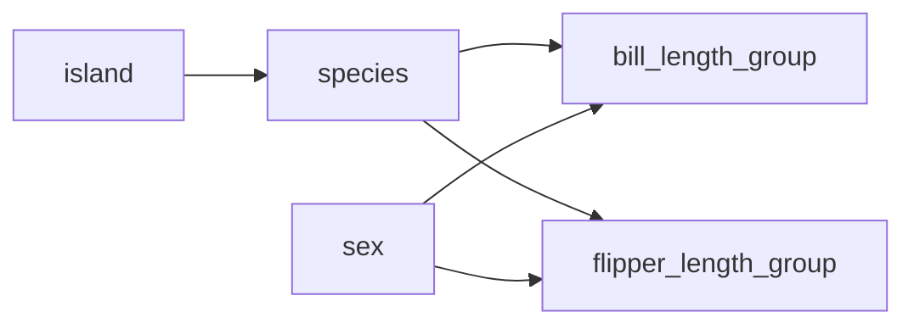

# План лабораторной работы №4 — байесовская сеть

**Состояние на 31.10.2026:** работа выполнена в [lab04.ipynb](lab04.ipynb). Датасет и ТЗ сохранены без изменений; все пункты ниже реализованы, а notebook повторно запущен целиком в чистом ядре без ошибок ячеек. Граф и вопросы из плана использованы без подстройки под ответы.

## 1. Что требует ТЗ

Цель — научиться самостоятельно задавать структуру байесовской сети и исследовать, как новые сведения меняют вероятности. В [ТЗ](materials/lab04.pdf) обязательны:

1. Выбрать открытый набор данных, отличный от набора и готовой сети из [примера](https://www.kaggle.com/code/ademox02/bayesian-networks), описать объект, переменные, значения и осмысленные предполагаемые зависимости. Глубоких специальных знаний предметной области данные требовать не должны.
2. Изучить пропуски, редкие категории, число состояний и достаточность наблюдений; при необходимости дискретизировать числовые признаки собственным обоснованным способом.
3. **До построения сети** сформулировать минимум три содержательных вопроса.
4. Самостоятельно предложить и визуализировать читаемый ориентированный ациклический граф (DAG). Для основных рёбер объяснить зависимость и направление; одной корреляции для обоснования недостаточно.
5. Оценить таблицы условных вероятностей (CPT), изучить несколько интересных таблиц и сопоставить полученные значения с данными и ожиданиями. Необычные результаты объяснить.
6. Выполнить **не менее трёх различных вероятностных запросов**, для каждого сравнить распределение или вероятность до и после появления сведений и содержательно истолковать изменение.
7. Для одной переменной показать последовательность: без сведений → одно условие → два условия → три условия. Представить результаты таблицей или графиком и объяснить их через сеть.
8. Удалить одно ребро, заново оценить параметры изменённой структуры, повторить один запрос и объяснить различие, влияние структуры и пределы определения направления связей по наблюдениям.
9. Ответить, является ли модель причинной; отдельно обосновать любую причинную трактовку. Завершить выводами о найденных зависимостях, влиянии свидетельств, чувствительности к структуре и ограничениях.

В [README курса](https://github.com/lesopylka/ml_course_mai/blob/39d3023809a246853db83f4ec3b39c9798e5dfd1/README.md) срок обозначен как **две недели с момента выдачи**; дата выдачи и конкретный дедлайн в репозитории не приведены. Для полной оценки важны обязательные части, отсутствие критических ошибок и уверенное объяснение собственного решения на защите. Отдельного числового порога качества для ЛР4 нет. ТЗ ЛР4 не требует классификатор, train/test split или leaderboard: главный результат — интерпретируемая вероятностная модель и корректный вывод, а не метрика прогноза.

## 2. Выбранные данные и смысл переменных

**Palmer Penguins** — открытый набор наблюдений взрослых пингвинов на островах архипелага Палмера. Одна строка описывает одну птицу. В исходном [CSV](data/penguins.csv) 344 наблюдения и 8 столбцов; происхождение и SHA-256 записаны в [`data/SOURCE.md`](data/SOURCE.md). Данные доступны по лицензии CC0.

| Переменная | Значение | Роль в работе |
|---|---|
| `species` | Вид: Adelie, Chinstrap, Gentoo | Интересующая переменная для части запросов. |
| `island` | Остров наблюдения: Biscoe, Dream, Torgersen | Географическая информация о составе наблюдавшихся видов. |
| `sex` | Пол: female, male | Возможная связь с размерами тела. |
| `bill_length_mm` | Длина клюва, мм | После дискретизации — короткий/длинный клюв. |
| `flipper_length_mm` | Длина плавника, мм | После дискретизации — короткий/длинный плавник. |
| `bill_depth_mm`, `body_mass_g`, `year` | Глубина клюва, масса, год наблюдения | Сохранены в исходном CSV, но не входят в компактную сеть: дополнительные состояния и параметры потребовали бы больше данных и объяснений. |

Проверка исходного файла показала 11 пропусков `sex`, по 2 пропуска в каждом числовом столбце, по 0 — в `species`, `island` и `year`; для пяти выбранных переменных полны 333 строки. Категории вида и острова имеют соответственно частоты 152/124/68 и 168/124/52. Эти исходные частоты показаны и разобраны в notebook.

**Реализованная подготовка:** исходный CSV сохранён неизменным; строки с пропуском в выбранных пяти переменных исключены, осталось 333 наблюдения. Длина клюва разделена на `< 45` и `≥ 45` мм, длина плавника — на `< 200` и `≥ 200` мм. Частоты состояний и сочетаний родителей показаны в notebook. Для обеих структур применено одинаковое сглаживание: 0,5 псевдонаблюдения на состояние каждой колонки CPT. Исключение строк может внести смещение; пороги и обработка были зафиксированы до анализа запросов.

Некоторые сочетания вида и острова отсутствуют в выборке. Поэтому нули и особенно вероятности для ненаблюдавшихся комбинаций требуют осторожной трактовки. Выборка небольшая и не обязана представлять всех пингвинов или все острова.

## 3. Вопросы и сеть — зафиксированы до вычислений

Три вопроса для вероятностного вывода:

1. Как меняется `P(species = Gentoo)` при сведении, что плавник длинный (`flipper_length_group = long`)? Сравнить полные распределения видов до и после сведения.
2. Как меняется `P(species = Chinstrap)` при совместных сведениях `island = Dream` и `bill_length_group = long`? Показать также шаг только с островом, чтобы вклад каждого сведения был понятен.
3. Как меняется `P(flipper_length_group = long)` при сведениях `species = Chinstrap` и `sex = male`? Сравнить исходную вероятность, условие по виду и оба условия вместе.

Использованный DAG из пяти вершин и пяти рёбер:

Список рёбер без графической неоднозначности: `island → species`, `species → bill_length_group`, `sex → bill_length_group`, `species → flipper_length_group`, `sex → flipper_length_group`.

- `island → species`: остров связан с тем, какие виды наблюдались там; направление служит факторизации распределения наблюдений и **не** означает, что остров сам по себе создаёт вид. Проверить, не слишком ли сильное предположение возникает из отсутствующих сочетаний.
- `species → bill_length_group` и `species → flipper_length_group`: вид связан с морфологией; направление соответствует описанию размеров через принадлежность к виду. Оно остаётся гипотезой о структуре распределения, не доказательством причинности.
- `sex → bill_length_group` и `sex → flipper_length_group`: пол может быть связан с размерами взрослых птиц; проверить эту гипотезу по данным, не утверждая её автоматически.

Модель предполагает условную независимость двух измерений при известных виде и поле, а также не содержит прямой связи `island → размеры`. Эти упрощения нужно назвать и обсудить, особенно если сопоставление с данными обнаружит заметное расхождение. Не добавлять ребро лишь из-за корреляции или для красивого результата.

Для последовательного evidence выбрать полное распределение `species`: без условий → `island = Dream` → дополнительно длинный клюв → дополнительно короткий плавник. Для опыта со структурой удалить `species → flipper_length_group`, заново оценить CPT и повторить первый запрос о `P(species | flipper_length_group = long)`. Все остальные данные, категории и способ сглаживания оставить теми же. Изменение здесь ожидается по топологии графа, но его размер и интерпретацию установить только после расчёта.

## 4. Пошаговое выполнение — завершено

### Этап 1. Подготовить воспроизводимый отчёт и проверить данные

- [x] Создать `lab04.ipynb` с целью работы, ссылками на ТЗ и датасет, описанием объекта и всех исходных переменных. Импорты, версии пакетов и настройки собрать в начале.
- [x] Проверить имеющееся Python-окружение и записать способ воспроизведения. Для пяти узлов достаточно явной оценки CPT и точного перебора 72 состояний внутри notebook; дополнительная библиотека байесовских сетей не потребовалась.
- [x] Загрузить только `data/penguins.csv`; показать форму, типы, допустимые значения, пропуски и частоты категорий. Исходный файл не перезаписывать.
- [x] Проверить дубликаты и смысл строк; определить, нет ли признаков, что одна птица могла наблюдаться повторно. Если по упрощённому CSV это не устанавливается, явно обозначить ограничение, а не заявлять независимость всех строк как факт.
- [x] Применить выбранное правило для пропусков и дискретизацию; показать число оставшихся строк, распределения двух новых категорий и размеры комбинаций родителей будущих CPT. Зафиксировать пороги, обработку границы и причину выбора.
- [x] Если отдельные комбинации оказываются слишком редкими, объяснить выбранное сглаживание и пределы достоверности оценок; не превращать отсутствующие сочетания в уверенное содержательное утверждение.

### Этап 2. Зафиксировать вопросы и построить граф

- [x] До расчёта параметров явно записать три вопроса из раздела 3 и план эксперимента с evidence.
- [x] Представить пять вершин и пять рёбер как собственную гипотезу, программно проверить отсутствие циклов и нарисовать читаемую схему с подписями состояний.
- [x] Для каждого ребра объяснить смысл зависимости и выбор направления. Выписать также ключевые условные независимости и возможные пропущенные связи.

### Этап 3. Оценить и проверить условные вероятности

- [x] Оценить CPT из подготовленных строк, применив один прозрачный метод оценки и сглаживание только там, где оно обосновано редкостью/нулями; зафиксировать его параметры.
- [x] Проверить, что каждая условная колонка CPT неотрицательна и суммируется в 1; проверить имена и порядок состояний при выводе.
- [x] Показать и разобрать как минимум `P(species | island)`, `P(bill_length_group | species, sex)` и `P(flipper_length_group | species, sex)`; сопоставить несколько значений с эмпирическими частотами и размерами групп.
- [x] Необычные или малонадежные оценки объяснить через объём соответствующей группы, дискретизацию, сглаживание и допущения графа.

### Этап 4. Выполнить три вероятностных запроса

- [x] Для каждого из трёх вопросов вывести исходное и условное распределение, отдельно указав абсолютное изменение интересующей вероятности и все заданные условия.
- [x] Проверить, что ответы нормированы, свидетельства допустимы, а результаты получены именно вероятностным выводом в обученной сети.
- [x] Интерпретировать каждый результат в терминах вида, острова и измерений; отделять наблюдательную ассоциацию от причинного утверждения.

### Этап 5. Исследовать последовательное evidence

- [x] Для `species` выполнить четыре состояния знаний из раздела 3 на **одной и той же** сети: ничего → остров Dream → длинный клюв → короткий плавник.
- [x] Представить таблицу или график с вероятностями всех трёх видов на каждом шаге, чтобы суммы по строкам равнялись 1.
- [x] Объяснить изменения через пути в графе и ограничения маленьких или редких групп; не выдавать добавление evidence за физическое вмешательство.

### Этап 6. Проверить чувствительность к одному ребру

- [x] Скопировать исходную структуру, удалить только `species → flipper_length_group`, проверить DAG и заново оценить параметры **на тех же подготовленных строках** тем же методом.
- [x] Повторить вопрос 1 для исходной и изменённой сетей, сравнить полное распределение и изменение `P(species = Gentoo)`.
- [x] Объяснить через факторизацию, почему удаление ребра меняет доступные пути зависимости; обсудить, можно ли определить направление ребра по наблюдательным данным и почему одного такого опыта недостаточно для причинного вывода.

### Этап 7. Выводы, проверка и защита

- [x] Ответить явно, является ли построенная сеть причинной моделью. Для каждого осторожного причинного предположения назвать внешнее основание; при отсутствии такого основания трактовать рёбра как модель статистических зависимостей.
- [x] Свести результаты: самые интересные зависимости, эффект дополнительных сведений, чувствительность к структуре, влияние пропусков, порогов, редких состояний и объёма выборки.
- [x] Выполнить notebook сверху вниз в чистом ядре; проверить отсутствие ошибок, читаемость графа/таблиц, совпадение всех чисел с текстом и покрытие каждого пункта ТЗ.
- [x] Подготовить объяснение для защиты: DAG, факторизация и CPT, сглаживание, дискретизация, условная вероятность, вероятностный вывод, evidence, различие ассоциации и причинности, ограничения выборки и причины изменения ответа после удаления ребра.

## 5. Полученный результат

Итог — воспроизводимый [`lab04.ipynb`](lab04.ipynb) с исходным описанием, кодом, графом, CPT, тремя запросами, опытом с последовательным evidence, описанием допущений, сравнением после удаления ребра и выводами. Длинный плавник меняет `P(Gentoo)` с 35,8% до 79,4%; после удаления ребра `species → flipper_length_group` эта вероятность остаётся 35,8%. Исходный CSV и ТЗ сохранены в `data/` и `materials/`; показатели относятся к выбранной модели и наблюдениям, а не к причинному эффекту или независимому тесту.

## 6. Источники

- [ТЗ ЛР4](https://github.com/lesopylka/ml_course_mai/blob/39d3023809a246853db83f4ec3b39c9798e5dfd1/bayesian/lab04.pdf) — локальная копия [`materials/lab04.pdf`](materials/lab04.pdf), SHA-256 `ff6a98bbf81d2d8c6f4fde1832277c356693620f4f8b7076dd1848445a9e8a`.
- [README курса](https://github.com/lesopylka/ml_course_mai/blob/39d3023809a246853db83f4ec3b39c9798e5dfd1/README.md) — список лабораторных, сроки и правила защиты. Репозиторий курса проверен на коммите `39d3023809a246853db83f4ec3b39c9798e5dfd1` от 30.10.2026.
- [Официальное описание Palmer Penguins](https://allisonhorst.github.io/palmerpenguins/reference/penguins.html) и [исходный CSV](https://github.com/allisonhorst/palmerpenguins/blob/8957207b78d6ccd1b4654a9dd9c9041b657478ab/inst/extdata/penguins.csv). Происхождение и лицензия также записаны в [`data/SOURCE.md`](data/SOURCE.md).
- [Пример из ТЗ](https://www.kaggle.com/code/ademox02/bayesian-networks) использует данные о здоровье и астме; его набор и структура сети здесь не используются.
